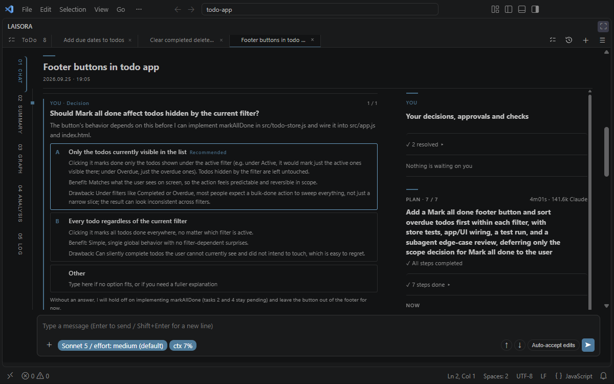
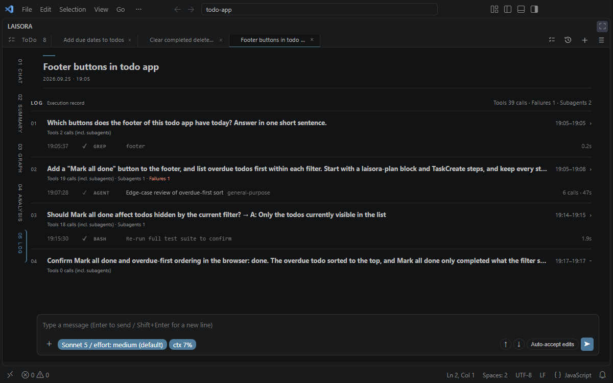
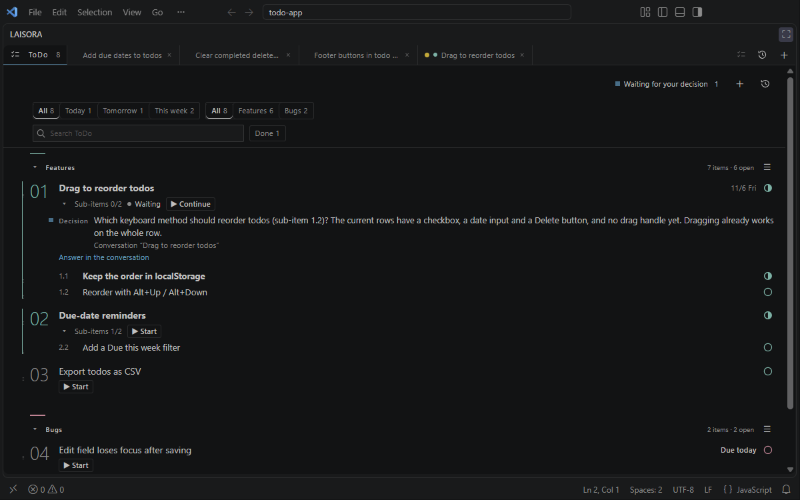
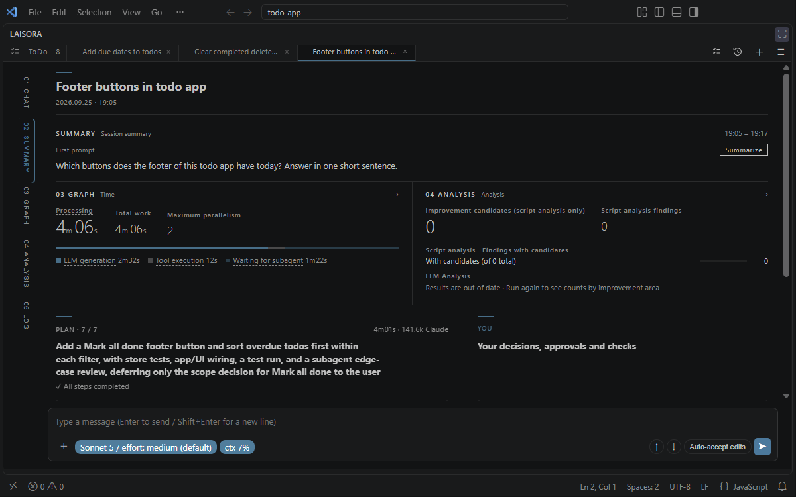
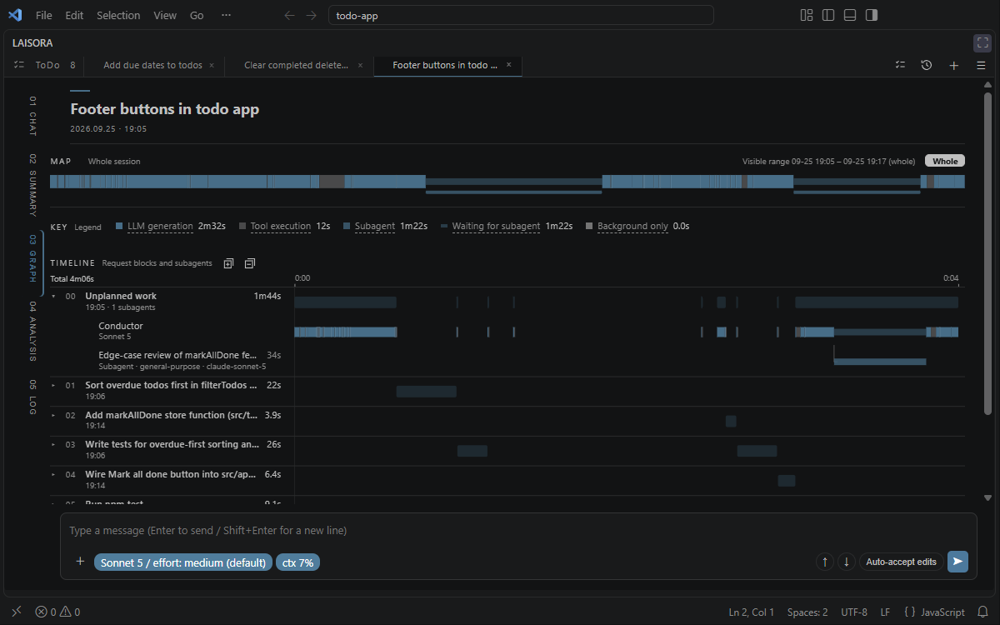
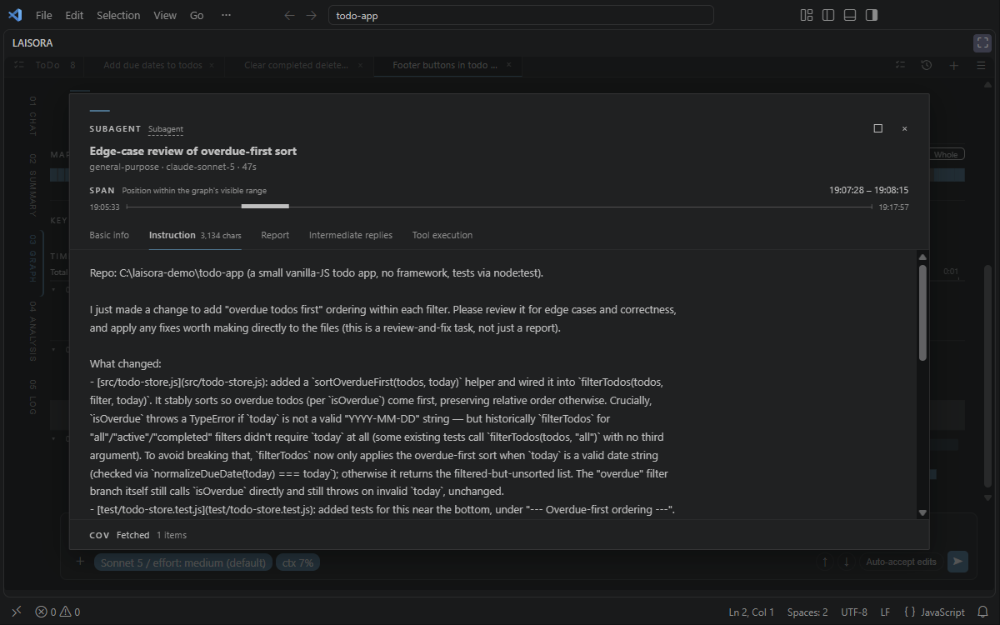
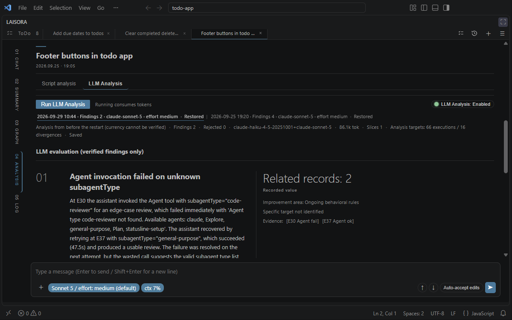

English | [日本語](README.ja.md)

LAISORA is a VS Code extension for Claude Code. Your conversation with Claude appears in one view, CHAT, while tool runs go to a separate view, LOG; and a ToDo list carries work across conversations and days.

You don't need everything the CLI shows you. An AI agent runs command after command and rewrites code, and watching that log often leaves you unsure what it is doing, or why. I have found myself in that position more and more often.

Most of the time, what I need is the conversation: what I want to achieve and how to move forward. So in LAISORA, CHAT shows the conversation and tool runs go to LOG. Two panels beside CHAT, PLAN and YOU, show what Claude is working toward and what needs me. For work that spans days, the ToDo keeps what I am trying to achieve in one place between conversations. Analysis of the work log points to what to change next. The details never go away: when something catches my eye, LOG is one click away, and I can always ask Claude to explain.

LAISORA suits people who let Claude run, follow it through the conversation, PLAN, and YOU, and judge the results. If you prefer to review each step yourself before Claude continues, Claude Code in the terminal fits that way of working better.

In short:

- **CHAT and LOG:** Claude's replies stay readable; every command and file operation is listed in LOG, grouped by your request.
- **ToDo:** a list of your work that Claude keeps in order, with a memo on each item so a new conversation can start from where things stand.
- **Requests for you in one place:** approvals, decisions, and checks collected in YOU, beside the conversation.
- **Where the time and tokens went, and what to change next:** time and tokens by model, by role and by subagent, plus failures, counted from the work log. When you want more, an LLM analysis proposes concrete improvements.
- **Tabs:** several conversations side by side.
- **Handoff:** continue a long conversation in a fresh one without losing your messages or decisions.
- **Agent orchestration (off by default):** let Claude hand parts of the work to other agents with roles you set.
- **Where it runs:** a local, trusted VS Code window; tested on Windows. Remote and container setups are not supported (details under [Requirements](#requirements)).
- **Price:** LAISORA is free and open source (MIT). It runs your own Claude Code: with a subscription, use counts against your plan's limits; with an API key, it is billed to that key. Codex and Antigravity runs, if you add them, use those CLIs' own accounts.

## The screen at a glance

- **Views of each conversation tab:** **CHAT** (the conversation), **LOG** (every tool call, grouped by your request), **SUMMARY** (key figures and an overview), **GRAPH** (a timeline of who worked when), and **ANALYSIS** (where time, tokens, and failures went).
- **Beside CHAT:** **PLAN** (the goal Claude is working toward in this conversation, and its steps) and **YOU** (what is waiting for you: approvals, decisions, and checks Claude asks you to make on your machine).
- **Fixed first tab:** **ToDo** (your list of work across conversations and days).

A **turn** is one round of Claude working on your message, until it replies. A **decision card** is how Claude asks you to choose: options with pros and cons, a recommendation, and what it will do if you do not answer. A **subagent** is a helper agent that Claude starts to handle part of a task. The **work log** is the record Claude Code keeps of each conversation, with every message and tool call; SUMMARY, GRAPH, ANALYSIS, and LOG are built from it.

## CHAT: the conversation, without tool output in between

**Why:** when you follow the work through the conversation, the output of many commands breaks Claude's replies into pieces, and what Claude is telling you gets buried. Most of that output you never need to read; it waits in LOG for the moment something catches your eye.

CHAT shows what Claude says to you, along with approval requests, failures, and relevant notices. Tool activity goes to LOG, so a long run of commands does not interrupt the reply. When you need the details, open LOG: every tool call (commands, file reads and edits), grouped by your request, with input and output previews, duration, and marks for failures.

Each reply has a footer with a copy button and its time, and you can copy your own messages too. At the end of a reply, LAISORA can list the files Claude edited in that turn with the lines added and removed; click a file to compare it before and after the turn, without digging through LOG.

The screenshot above shows CHAT with PLAN and YOU beside it. Below is LOG for the same conversation: each of your requests is a numbered group of the tool calls it led to. Only the latest request is open; a folded request still shows its last tool call.

## ToDo: carry multi-day work across conversations

**Why:** each new conversation starts from nothing, so work that spans days loses its thread, and you end up explaining the same background again.

The ToDo tab keeps that thread. It is always the first tab and cannot be closed, and each conversation can also open the list as a drawer (a panel over the conversation) from the icon just left of its history icon. Claude keeps the list in order, and every change Claude makes can be seen and undone. Each item is where its conversations start and resume. Items are sorted into groups, such as one per project.

The ToDo is not PLAN. PLAN shows Claude's steps inside one conversation; the ToDo is your list across conversations and days.

**When you start the list.** Press **+** in the ToDo header and choose **New task** (only the title is required) or **New group**. Or ask Claude in any conversation ("add this to the ToDo"), or paste a screenshot of a request or an error. Claude adds and updates items without asking for approval.

**When you want to pick up yesterday's work without explaining it again.** Start a conversation from an item with ▶ Start, and come back to it later with ▶ Continue. Each item has three kinds of notes:

- the **work memo**, which LAISORA asks Claude to keep up to date while it works: where things stand, what comes next, what was decided, what is still open, and the files involved. Only Claude writes it.
- **your notes**, a separate field that is yours to write.
- **references**: links (URLs or file paths) and images you attach to the item. Claude can read them too.

When you start a conversation from an item, Claude gets going on its own: it reads the item, its notes, and its references, then tells you what it understood, what is missing, and what it would produce, and waits for your answer before changing anything. (LAISORA asks Claude to work this way.) In practice it often reads the files involved too before it reports.

**When something comes up that you do not want to deal with right now.** Press **Add to ToDo** under a finished reply. LAISORA asks Claude to turn that reply's topic into one item with a work memo, place it where it fits, and tell you where it went, while your current conversation carries on. **Add to ToDo and start a new conversation** asks the same, then opens the new item in a fresh tab if Claude added exactly one item. Each button starts a Claude turn. The buttons appear while the ToDo is on.

**When a task is too big for one conversation.** Break it into sub-items, then split a sub-item into its own conversation. Claude in the new conversation receives a brief built from the item, the parent's work memo, and their references, not the whole history of the parent conversation. As with ▶ Start, LAISORA asks Claude to check its understanding with you first.

**When several pieces of work are running and you lose track of what needs you.** Decisions and checks that Claude asked for in an item's latest conversation appear under that item, so you can see which work is waiting on you. Answer them in the ToDo or in the conversation; either closes them in both. When you answer a decision card in a conversation linked to an item, LAISORA records the time, the conversation, the card title, the option you chose, and your answer on the item, so what you decided stays with the work.

**When the list gets messy.** Ask Claude to tidy it: move, merge, split, or reword items. Claude applies the changes right away. Every change it makes appears in the ToDo history and can be undone there one by one. In the conversation, a turn's ToDo changes appear on one ToDo card, and **Take all back** on that card reverts them at once. You can add and edit items yourself and drag them to reorder.

Claude leaves your recent work in place. It does not move or reword:

- items in progress, and the items that contain them;
- items you changed in the last two days;
- items you moved in the last thirty days.

If it rewords an item you wrote, your original title is kept.

**Where the ToDo lives.** On this PC, in VS Code's extension storage, shared by all VS Code windows. It brings in no outside service, account, or connector, and there is no MCP server to install: Claude uses tools that LAISORA provides inside the conversation. It is not synced to other PCs or shared with a team. Where its content is sent is under [Where data is stored and where it is sent](#where-data-is-stored-and-where-it-is-sent). Turn it off with `laisora.todo.enabled`.

## Requirements

- The Claude Code CLI, installed and signed in with your own account. LAISORA runs `claude` from your PATH, or the path in `laisora.claude.executablePath`. If your Claude Code uses a JavaScript entry point, Node.js is also required.
- VS Code 1.90 or later, in a local, trusted window. WSL, Remote SSH, Dev Containers, untrusted workspaces, and virtual workspaces are not supported.
- Windows is the tested platform. macOS and Linux are experimental: automated checks run on Apple silicon macOS and x64 Ubuntu after every release, but conversations with the real Claude and delegation to Antigravity or Codex have not been verified there.

If `ANTHROPIC_API_KEY` is set in your environment, Claude Code uses it, and usage is billed to the API rather than your subscription; LAISORA tells you so in the conversation. See [Authentication and API keys](#authentication-and-api-keys) to change this.

## Install and open

Install **LAISORA** from the Extensions view in VS Code (Visual Studio Marketplace). Open it from the LAISORA icon in the activity bar or run **LAISORA: Open** from the command palette.

The interface is available in English and Japanese; some diagnostic messages remain in Japanese.

## Getting started

LAISORA opens with the ToDo tab first and conversation tabs after it. A new, empty conversation shows the LAISORA mark, a short greeting, a card with what is new in this version, and a tip; each new conversation shows the next tip. Both cards disappear when you send your first message and can be turned off on the settings page.

Things to try first:

1. Ask Claude for something small in your project, such as explaining a file or fixing a minor bug. The reply appears in CHAT; open LOG to see the commands and file operations behind it.
2. Look at PLAN beside CHAT. When Claude declares a goal and steps, they appear there with their status.
3. When Claude needs you, the request appears in YOU: approve a tool, choose an option on a decision card, or confirm a check.
4. Under a finished reply, press **Add to ToDo**. This asks Claude to create the item. Or open the ToDo tab and use **+** to add an item yourself.

What uses your plan or API key is listed under [Where data is stored and where it is sent](#where-data-is-stored-and-where-it-is-sent).

## What you can do

### Run several conversations side by side

**Why:** a long task in one conversation should not stop you from starting another, and switching should not lose what you were typing.

Each conversation is a tab that keeps its own draft, view, and scroll position. A tab stays lit while its subagents are still running, even after Claude's reply has finished, so you can tell it is not done yet. Open past conversations from the history list and resume them in the folder where they were started. Rows in the history list can be renamed or hidden; hiding keeps the conversation's record, and **Show hidden** brings it back. By default, LAISORA reopens the tabs that were open when the window was last closed or reloaded.

### Follow the plan and the timeline of the work

**Why:** when you are not reading every step, you still need a short answer to "where are we?": how far along Claude is, what is left, and which part is taking so long.

PLAN beside CHAT shows the goal Claude declared, its steps and their status, who is working on each, elapsed time, and tokens. It stays for the whole goal, across messages. Completed steps fold into one line; click it to expand. Without declared steps, it shows the work observed now. In a narrow window, a one-line bar under the title opens PLAN and YOU as a drawer. By default, LAISORA asks Claude to keep its plan up to date.

Open the other views when you want to look more closely:

- **SUMMARY**, for "how did this conversation go overall?": the key figures from GRAPH and ANALYSIS, PLAN and YOU side by side, and earlier requests with their steps, time, and tokens. The summary button at the top asks a model for a short summary of the conversation.
- **GRAPH**, for "who was working when, and where was the waiting?": a timeline of the main Claude, its subagents, and background tasks. Each step of the plan is a row you can unfold to see the main Claude and the subagents that worked on it. A map of the whole conversation lets you narrow the time range shown, and waiting for subagents is shown separately from tool calls. Open a subagent to read the full instruction it was given, which helps when a subagent did something you did not expect.
- **ANALYSIS**, for "where did the time and tokens go, and what should I change?": see [below](#see-where-time-and-tokens-went-then-get-improvements-to-make-next).

These figures are computed locally from the work log, without calling a model. When the record is incomplete, the views say so instead of showing partial numbers as complete.

The screenshots below show SUMMARY, GRAPH, and the instruction given to a subagent opened from GRAPH.

### Answer approvals and decisions, and steer a running turn

**Why:** in a long conversation, a question for you is easy to miss while Claude waits for the answer; and when Claude heads the wrong way, you want to correct it without waiting for the turn to end.

YOU collects approvals, decisions, and checks on your machine, each linking back to where it was asked in CHAT. Resolved items fold into one line, and a decision or check you no longer need can be dismissed. By default, LAISORA asks Claude to present decisions and checks this way.

Approve or deny tool requests in CHAT. Beside the message box you can:

- send more instructions while Claude is working, or interrupt it;
- search the conversation (Ctrl+F);
- choose the model, the effort (how much reasoning the model does), and the permission mode.

An instruction sent during a turn reaches Claude after its current step, so its behavior may not change at once. The model chip (the small label showing the model) shows the effort Claude Code actually applies, which can differ from what you asked for. Enter sends and Shift+Enter inserts a new line; swap them with `laisora.composer.sendKey` or on the settings page.

When the claude.ai usage limit stops a conversation, LAISORA can resume it automatically after the limit resets, so a long task does not sit idle until you come back. This uses the same setting as Claude Code in the terminal, so changing it in LAISORA changes it there too.

### See where time and tokens went, then get improvements to make next

**Why:** the finished result does not show where the time and tokens went, or where the agent struggled or repeated itself. And numbers alone leave the real question open: so what do I change? LAISORA has a model read the work log for you (the latest part, if the log is long), so you get an answer instead of a log to read.

**First, the numbers.** ANALYSIS shows time by model and in tool calls, time and tokens by role (worker, reviewer, and so on), with each run's executor (the agent or CLI that ran it), model, and effort, failures by kind, and each plan step's figures. Its script analysis runs fixed rules locally: it classifies failures and flags operations that match a rule table of conventions, even when they succeeded. GRAPH shows the same work over time, by subagent.

**Then, what to change.** The **LLM Analysis** tab asks a model to read the work log and propose concrete changes to your workflow, instructions, and settings. Each proposal links back to the records behind it, and you can start a new conversation to act on the ones you agree with. Saved analyses can be reopened after a restart.

An LLM analysis runs only when you start it, with the model and effort selected for the conversation. LAISORA tells you before it runs that it uses tokens. Turn it off with `laisora.workLog.llmAnalysis`. Proposals are model interpretations. LAISORA checks that the records and numbers they cite match the work log, but the overall judgment can still be wrong, so look at the evidence behind a proposal.

### Delegate work to subagents and other CLIs (agent orchestration)

**Why:** when one agent searches, edits, and reviews in the same conversation, everything it read while searching stays with it for the rest of the work, and in the end it reviews its own change.

Agent orchestration lets Claude hand parts of the work to other agents with roles you set, for example one agent to search the code, another to make the edits, and a third to review the result independently. LAISORA's default instruction tells Claude to delegate only when separating work, isolating context, or an independent judgment is worth the cost of passing the work over.

Agent orchestration is off by default. Turn it on in the agent orchestration settings on the LAISORA settings page. There, the roster (the list of roles Claude can delegate to) starts with worker, explorer, and reviewer, and you set a model and effort for each. Codex and Antigravity can be added as external executors when their CLIs are installed. Roster changes apply from the next conversation.

### Keep outdated notes out of CLAUDE.md, rules, and memory

**Why:** outdated notes keep steering Claude. Claude tends to write what it learns into CLAUDE.md, rules, and auto memory (the notes Claude Code saves for itself and reads in later conversations), including things that stop being true: how a particular model behaves, workarounds for one version, one-off observations. These notes pile up and steer every later conversation long after they are outdated. Claude then follows a rule that no longer applies, and you have to hunt down which note caused it.

While this protection is on, LAISORA:

- tells Claude, at the start of each conversation, where each kind of knowledge belongs;
- refuses additions to CLAUDE.md, CLAUDE.local.md, AGENTS.md, rules, and auto memory that name a model or its version, or that pair Claude, Codex, Antigravity, or one of your agents or models with effort or with a claim about what it is good or bad at, because such notes go stale when the models change;
- refuses shell commands that write to those files, whatever they contain, so Claude has to make the change as an edit that can be checked;
- lets only the main Claude write to auto memory, and only the kinds of notes that belong there. If you turn on `laisora.memory.blockProjectType`, notes on how far ongoing work has got are refused too, because they linger after the work is finished or the plan changes;
- stops subagents, which see only a slice of the work, from editing CLAUDE.md, rules, settings, and hooks. They put the change they propose in their report, and the main Claude decides.

Codex and Antigravity runs are not blocked from changing these files. Whether or not this protection is on, the result of such a run tells the main Claude which of these files it changed.

The protection is on by default. Turn it off on the settings page or with `laisora.guard.enabled` to let Claude Code write these files as it normally does. Changes apply from the next conversation you start or resume.

### Hand off a long conversation to a new one

**Why:** when Claude Code compacts a long conversation on its own, it summarizes everything, including your requests and the decisions you made, at a moment you did not pick. Details you cared about can be summarized away. A handoff starts when you choose, or at a threshold you set; it carries your own messages word for word, and copies the recorded decisions into the next conversation as they are, instead of summarizing them again.

Hand off an idle conversation: LAISORA creates a new conversation that starts from a summary and your messages since the previous handoff, while the original is kept unchanged. The continuation starts with its summary card. A recorded decision stays through later handoffs until you tell Claude it is settled. If the conversation is linked to a ToDo item that has a work memo, that memo is the main content of the handoff, and ▶ Continue then opens the new conversation.

The summary itself can still omit or misread details, so check important requirements when you continue. To hand off automatically when the context reaches a threshold, turn on `laisora.handoff.auto.enabled` (off by default).

You can also export a conversation to Markdown.

### Open files from links in replies

**Why:** replies mention files all the time; a link opens the file in one click instead of you copying the path and searching for it.

LAISORA asks Claude to write local files as links; click one to open it at that location in the editor. Within the workspace and the folder where the conversation was started, Office documents, PDFs, and other file types you choose open in their default app, and folder links open in the file manager. Other files open only if you allow it in user settings, and then after confirmation in a read-only editor by default. Network shares (UNC paths) and device paths are always refused.

### Small conveniences

- Show your own name in place of YOU, and pick an accent color.
- Keep the CLIs current without doing it by hand: LAISORA updates a natively installed Claude Code, the standalone Codex CLI, and the Antigravity CLI installed by its own installer in the background. An update starts only while no turn or external run is running.

## Settings

The LAISORA settings page opens from **Settings** in the ☰ menu of a conversation or with **LAISORA: Open Settings**. Every LAISORA setting is also listed in VS Code Settings under `laisora.*`, with its description. The one exception is the automatic resume after a usage limit: you can change it on the LAISORA settings page, but it belongs to Claude Code, so it is not under `laisora.*`.

## Sign-in, saved choices, data, and troubleshooting

### Authentication and API keys

**Why:** an `ANTHROPIC_API_KEY` left in your environment makes Claude Code bill the API instead of your subscription.

By default LAISORA passes the environment through, so that key is used as described under [Requirements](#requirements). Set `laisora.claude.apiKeyPolicy` to `subscriptionOnly` (user setting, also on the settings page) to remove the key from the launched Claude Code process and use your signed-in subscription. Other Claude Code or Anthropic environment variables and settings that the process inherits can affect authentication and the endpoint.

If Claude Code cannot be found, set `laisora.claude.executablePath` in your user settings. A workspace cannot supply this setting.

### How far your model, effort, and permission-mode choices carry

The model you choose is saved in Claude Code's shared `~/.claude/settings.json`, so later Claude Code sessions use it too. The effort you choose is remembered per model, and new conversations start with it. Two exceptions last only for the current conversation: the `max` effort, and the effort for a model whose settings key LAISORA does not know.

Changing the permission mode in LAISORA does not rewrite Claude Code's shared default. LAISORA remembers the mode you chose, except `bypassPermissions`, which is never carried into future conversations. That mode allows file edits and commands without the usual permission prompts.

### Where data is stored and where it is sent

- **Stored locally:** LAISORA reads Claude Code's local conversation records to show history and the work log, and saves its state, the ToDo, and analysis results in its VS Code extension storage.
- **Computed locally:** the figures in SUMMARY, GRAPH, ANALYSIS, and LOG, and script analysis, without calling a model.
- **What uses your plan or API key:** chat, LLM analysis, the SUMMARY summary, session-name suggestions, handoff, and Add to ToDo. Each sends the content it needs through Claude Code. The SUMMARY summary and session-name suggestions use a small model, whatever model the conversation uses; session-name suggestions work even when LLM analysis is turned off. What Claude reads from the ToDo, which can include items from other groups, goes only where the conversation already goes.
- **Sent to other CLIs:** with agent orchestration, work handed to Codex or Antigravity goes to those CLIs.
- **Updates:** to keep the CLIs current, LAISORA runs each CLI's own updater, and before updating Codex it asks OpenAI's release server and GitHub for the latest version number. These requests carry no conversation content. Background updates can be turned off per CLI on the settings page.
- **Usage statistics:** when VS Code telemetry is off, the Claude Code that LAISORA starts sends no usage statistics, unless you set `DISABLE_TELEMETRY` yourself. A change applies to Claude Code processes started afterwards.

Your Claude Code settings, hooks, and configured tools affect execution and external connections, as they do when you use Claude Code directly. Logs and saved diagnostics can contain conversation content; review them before sharing.

### Troubleshooting

- **Cannot start a conversation:** run `claude` in a terminal and check that it starts and is signed in. Then see **View → Output → LAISORA**.
- **No working directory:** open a folder or set `laisora.defaultCwd`. A conversation resumes in the folder where it was started; if the project has moved, move it back to that path or start a new conversation.
- **Usage limit or analysis failure:** check the reported error and your Claude account. A failed analysis does not mean the conversation had no problems.
- **An instruction did not take effect immediately:** read the continuing conversation before resending it. Delivery and the model's response are separate steps.

## How LAISORA came about

LAISORA itself is developed through conversations with Claude Code, Codex, and Antigravity. It grew out of a challenge I met during development: being unable to keep up with the AI's work logs.

## License

[MIT](LICENSE).
